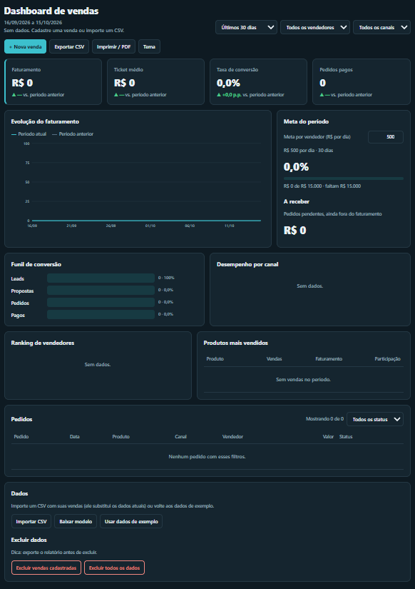

# Dashboard de Vendas

Painel de vendas em HTML, CSS e JavaScript puro, sem bibliotecas nem servidor. Mostra faturamento, ticket médio, conversão e evolução das vendas, com regras de negócio reais.

**Demo:** https://potiflux-cloud.github.io/dashboard-vendas/



## Funcionalidades

- **Indicadores:** faturamento, ticket médio, taxa de conversão e pedidos pagos, com variação contra o período anterior.
- **Gráfico de evolução** em SVG, com período anterior sobreposto e tooltip.
- **Meta do período** editável, com progresso e valor a receber.
- **Funil de conversão**, desempenho por canal, ranking de vendedores e produtos mais vendidos.
- **Filtros** por período, vendedor, canal e status.
- **Nova venda** pelo formulário, salva no navegador.
- **Marcar como pago:** pedidos pendentes ganham o botão *Marcar pago*. Ao confirmar, o faturamento sobe, o valor a receber desce e a mudança fica salva.
- **Excluir dados:** apague só as vendas cadastradas ou todos os dados (exemplo, importados e cadastrados) e comece do zero.
- **Importar CSV** e **exportar relatório** em CSV ou PDF.
- **Tema claro e escuro**, responsivo para celular.

## Regras de negócio

| Indicador | Regra |
|---|---|
| Faturamento | Soma dos pedidos pagos (pendentes e cancelados ficam de fora) |
| Ticket médio | Faturamento ÷ pedidos pagos |
| Conversão | Pedidos pagos ÷ leads do período |
| A receber | Soma dos pedidos pendentes |
| Marcar como pago | Só pedidos pendentes. O pagamento vale na data original do pedido |
| Comparação | Período anterior de mesma duração; conversão em pontos percentuais |
| Meta do time | Meta individual × nº de vendedores × dias |

A lista completa está em [docs/REQUISITOS.md](docs/REQUISITOS.md).

## Como rodar

Não precisa instalar nada.

1. Baixe ou clone o repositório.
2. Abra o `index.html` no navegador (ou use a extensão Live Server do VS Code).

## Usando o painel

### Cadastrar uma venda

Clique em **+ Nova venda** e preencha data, produto, valor, canal, vendedor e status. Produto, canal e vendedor são campos de texto com sugestões, então dá para criar nomes novos. A venda aparece na tabela de pedidos com a etiqueta *manual* e pode ser removida pelo **×**.

### Marcar um pedido como pago

Na tabela de pedidos, filtre por **Pendente** e clique em **Marcar pago** na linha do pedido. Confirme, e o painel recalcula faturamento, ticket médio, conversão e valor a receber.

### Excluir dados

No card **Dados → Excluir dados**:

| Botão | O que apaga |
|---|---|
| Excluir vendas cadastradas | Só as vendas lançadas pelo formulário |
| Excluir todos os dados | Dados de exemplo ou importados **e** vendas cadastradas (a meta é mantida) |

Ambos pedem confirmação e não podem ser desfeitos. Para voltar ao início, use **Usar dados de exemplo**. Dica: exporte o relatório antes de excluir.

### Usando seus dados

Clique em **Importar CSV** (use **Baixar modelo** para ver o formato):

```csv
data;canal;vendedor;etapa;produto;valor;status
2026-10-01;WhatsApp;Ana Lima;pedido;Plano Presence;497;pago
2026-10-01;Instagram;Bruno Reis;lead;;;
```

| Coluna | Obrigatória | Valores |
|---|---|---|
| data | Sim | `AAAA-MM-DD` ou `DD/MM/AAAA` |
| canal | Sim | Texto livre |
| vendedor | Sim | Texto livre |
| etapa | Não | `lead`, `proposta` ou `pedido` |
| produto | Para pedidos | Texto livre |
| valor | Para pedidos | Número maior que zero |
| status | Para pedidos | `pago`, `pendente` ou `cancelado` |

Para buscar de uma API, preencha `API_URL` no `script.js`. Ela deve devolver um array JSON com as mesmas colunas. Nesse modo o status é atualizado na origem, e o botão *Marcar pago* avisa isso.

## Limitações

- Os dados ficam no `localStorage` do navegador: não são compartilhados entre dispositivos e somem se o usuário limpar os dados do site.
- O faturamento é contado na **data do pedido**, não na data do pagamento. Marcar como pago um pedido antigo altera o período em que ele foi feito.
- Cada venda cadastrada à mão entra como um lead que já converteu, o que infla a taxa de conversão. Para uma conversão real, importe um CSV com linhas `lead` e `proposta`.

## Estrutura

```
dashboard-vendas/
├── index.html      # estrutura da página
├── style.css       # tema, layout e responsivo
├── script.js       # dados, regras de negócio e renderização
└── docs/
    ├── REQUISITOS.md
    └── prints/
        └── painel.png
```

## Tecnologias

HTML5, CSS3 (variáveis, grid, flexbox) e JavaScript (ES2020), com gráfico em SVG gerado por código e persistência em `localStorage`.

## Próximos passos

- Data de pagamento separada da data do pedido
- Backend para compartilhar dados entre dispositivos
- Autenticação e múltiplos usuários
- Metas por vendedor e por mês

## Autor

Matheus | Potiflux · [@potiflux-cloud](https://github.com/potiflux-cloud)